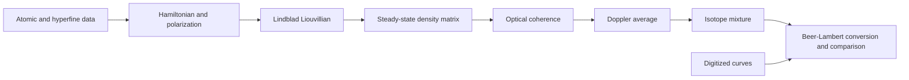

# QuAntü

**Neutral-atom-based quantum computing in Chile — ATE250066**

QuAntü is an **ANID Thematic Research Ring project** bringing together Algorithms, Experimental, and Theory groups.

## Project leadership and research groups

| Member | Project role | Group led |
| --- | --- | --- |
| [Dardo Goyeneche](https://github.com/dardomg) | Director | [Algorithms](algorithms/README.md) |
| Jerónimo Maze | Alternate Director | [Experimental](experimental/README.md) |
| [Ariel Norambuena](https://github.com/Ariel-Norambuena) | Principal Investigator | [Theory](theory/README.md) |

This repository currently brings together rubidium vapor absorption models, open quantum systems, reference data, a technical report, and educational materials. Python is the primary development and execution path; the original MATLAB implementations provide a reference for the models' provenance.

> **Scientific status:** research in progress. Historical fit metrics were reproduced by executing the three notebooks. The new Python implementations include numerical checks; absolute calibration and complete experimental validation remain pending.

[Technical report](theory/reports/technical-progress/main.pdf) · [Scientific background](docs/science.md) · [Installation and execution](docs/reproducibility.md) · [Traceability](docs/report-traceability.md) · [Data](docs/data-provenance.md) · [Inventory](docs/inventory.csv) · [Validation](docs/validation.md)

## Research groups and repository structure

Each group has an English README describing its objectives, current materials, and entry points.

| Group | Materials currently available | Start here |
| --- | --- | --- |
| Algorithms | Educational Qiskit notebook, workshop builder, requirements, and checks | [Algorithms README](algorithms/README.md) |
| Experimental | Digitized literature spectra, processed reference data, vapor-cell documentation, and an educational MOT animation | [Experimental README](experimental/README.md) |
| Theory | Rubidium D2 models, open-system examples, absorption notebooks, technical report, atomic references, and lectures | [Theory README](theory/README.md) |

```text
algorithms/
  education/qiskit/
experimental/
  data/{raw,processed}/
  education/mot/
  references/hardware/
theory/
  models/{density-matrix,interactive,open-quantum-systems}/
  notebooks/absorption/
  reports/technical-progress/
  references/{papers,atomic-data,rubidium-theory}/
  education/lectures/
  archive/theoretical-group/
docs/          shared scientific and repository documentation
scripts/       shared reproduction and validation commands
tests/         shared reference fixtures
validation/    selected numerical evidence
outreach/      shared QuAntü-STEM materials
```

The [repository map](docs/repository-map.md) details file provenance and group placement. [Shared documentation](docs/), [validation records](validation/), and [outreach materials](outreach/quantu-stem/) remain at the repository root. Group placement organizes the available material and does not imply that an experimental setup or hardware algorithm has been demonstrated.

## Quick start

Use Python 3.11 or later. From the repository root:

```powershell
python -m venv .venv
.venv\Scripts\python -m pip install -r requirements.txt
.venv\Scripts\python scripts/validate.py
.venv\Scripts\python theory/models/density-matrix/run_fast.py --quick
```

On Linux and macOS, use `.venv/bin/python` instead of `.venv\Scripts\python`.

To explore the dashboard:

```powershell
.venv\Scripts\python -m pip install -r requirements-dashboard.txt
.venv\Scripts\python -m streamlit run theory/models/interactive/dashboard_rb.py
```

Simulation commands and computational cost controls are documented in the [reproducibility guide](docs/reproducibility.md). For OQS, run `python theory/models/open-quantum-systems/two_level.py check`; the [OQS examples](docs/open-quantum-systems.md) cover dynamics and fluorescence. Small grids check that the implementation runs; they do not establish convergence.

## Theoretical spectroscopy workflow



The D2 model resolves hyperfine bases with magnetic sublevels: 36 states for ⁸⁵Rb and 24 for ⁸⁷Rb. The explicit `mF` basis represents polarization, while the current model has no Zeeman Hamiltonian. The absorption scale and affine frequency transformation are empirical; the result is not an absolute prediction in SI units.

## Documented spectroscopy results

| Report model | MSE | MAE | Evidence |
| --- | ---: | ---: | --- |
| Gaussian | 0.006772 | 0.054760 | Saved outputs in `Model_1.ipynb` |
| Isotope-aware Gaussian | 0.004758 | 0.052138 | Saved outputs in `Model_2.ipynb` |
| Microscopic susceptibility | 0.004004 | 0.048501 | Saved outputs in `Model_3.ipynb` |
| Density matrix | Pending | Pending | Common comparison protocol not yet completed |


[Automated reproduction](scripts/run_absorption_notebooks.py) confirmed these figures within the displayed rounding. These metrics use the dataset and processing from the original notebooks; they do not independently assess generalization. The [traceability matrix](docs/report-traceability.md) connects report claims with their evidence.

## Organization and preservation

The published collection preserves **126 working files** from the original folder (57.38 MiB of inventoried files). The [verifiable inventory](docs/inventory.csv) retains original paths and hashes of the source and incorporated files. The 11 meeting files were removed from the tree and history of the published branch; their originals remain in the working folder. Temporary review files and nested Git metadata are excluded.

The historical [theoretical-group](theory/archive/theoretical-group/) copy preserves figure variants that differ from the main folder. The [Qiskit workshop](algorithms/education/qiskit/) was incorporated as ordinary files from [neutral-atoms-qiskit-workshop](https://github.com/Ariel-Norambuena/neutral-atoms-qiskit-workshop), retaining its original credits in the English documentation and citation. The [repository map](docs/repository-map.md) explains each collection's origin.

## Language and provenance

Documentation, editable teaching material, notebook output, interfaces, code comments, and MOT video captions are maintained in English. Personal and institutional names, official logos, bibliographic titles, and exact source identifiers in `original_path` retain their original spelling. Original files outside this checkout remain unchanged.

## Report and references

The local report identifies **Alexis R. Legón**, Pontificia Universidad Católica de Chile / QuAntü Research Group, and covers May–July 2026. This attribution applies to the report; other materials retain their original authors and credits.

The associated [Overleaf project](https://www.overleaf.com/project/6a679a4b0c07d40f5ac1dd88) requires access. This import uses local files and does not guarantee agreement with the latest online revision. The [BibTeX bibliography](theory/reports/technical-progress/references.bib) preserves the report's scientific references.

## Contributions, rights, and next steps

Read [CONTRIBUTING.md](CONTRIBUTING.md) before adding results and [ROADMAP.md](ROADMAP.md) for pending milestones. Each new result should identify parameters, input data, environment, and reproduction commands.

This repository is **public**. No collection-wide open license has been assigned: papers, digitized materials, and third-party documents retain their rights and attributions. See [THIRD_PARTY_NOTICES.md](THIRD_PARTY_NOTICES.md). Report and workshop citations are separate from each component's reuse conditions.
