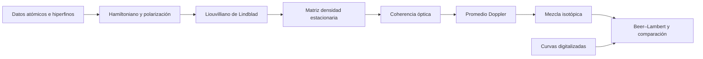
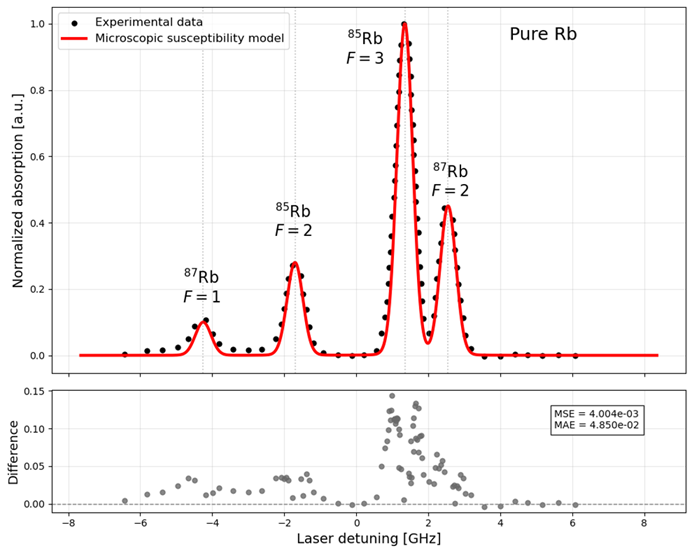

# QuAntü

**Neutral-atom-based quantum computing in Chile — ATE250066**

QuAntü es un proyecto **Anillo Temático de ANID** que integra los grupos de algoritmos, experimental y teórico.

## Dirección y grupos de investigación

| Integrante | Cargo en el proyecto | Grupo que lidera |
| --- | --- | --- |
| [Dardo Goyeneche](https://github.com/dardomg) | Director | Algoritmos |
| Jerónimo Maze | Director alterno | Experimental |
| [Ariel Norambuena](https://github.com/Ariel-Norambuena) | Investigador principal | Teórico |

Este repositorio reúne actualmente modelos de absorción de vapor de rubidio, sistemas cuánticos abiertos, datos de referencia, un informe técnico y materiales docentes. Python es la ruta de desarrollo principal; las implementaciones MATLAB originales permiten revisar la procedencia de los modelos.

> **Estado científico:** investigación en desarrollo. Las cifras de ajuste históricas se reprodujeron ejecutando los tres notebooks. Las nuevas implementaciones Python incluyen comprobaciones numéricas; la calibración absoluta y la validación experimental completa siguen pendientes.

[Informe técnico](reports/technical-progress/main.pdf) · [Fundamentos](docs/science.md) · [Instalación y ejecución](docs/reproducibility.md) · [Trazabilidad](docs/report-traceability.md) · [Datos](docs/data-provenance.md) · [Inventario](docs/inventory.csv) · [Verificaciones](docs/validation.md)

## Qué contiene

| Área | Material | Entrada |
| --- | --- | --- |
| Absorción D2 | Matriz densidad de ⁸⁵Rb y ⁸⁷Rb, respuesta estacionaria y promedio Doppler | [Modelos](models/density-matrix/) |
| Modelos progresivos | Gaussiano, mezcla isotópica y susceptibilidad microscópica | [Notebooks](notebooks/absorption/) |
| Exploración interactiva | Perfiles Voigt, temperatura, anchura y contribuciones isotópicas | [Interfaces Python](models/interactive/) |
| Sistemas abiertos | Dinámica de dos niveles y espectro de fluorescencia | [Modelo Python](models/open-quantum-systems/) |
| Datos de literatura | Curvas digitalizadas y versiones procesadas | [Brutos](data/raw/) · [Procesados](data/processed/) |
| Reporte | Fuentes LaTeX, bibliografía, figuras y PDF | [Informe](reports/technical-progress/) |
| Formación | Taller Qiskit, animación MOT y clases | [Educación](education/) |
| Divulgación | Evento QuAntü-STEM | [Materiales del evento](outreach/quantu-stem/) |
| Fuentes | Artículos, parámetros atómicos y documentación de celdas | [Referencias](references/) |

## Inicio rápido

Python 3.11 o posterior. Desde la raíz del repositorio:

```powershell
python -m venv .venv
.venv\Scripts\python -m pip install -r requirements.txt
.venv\Scripts\python scripts/validate.py
.venv\Scripts\python models/density-matrix/run_fast.py --quick
```

En Linux y macOS usa `.venv/bin/python` en lugar de `.venv\Scripts\python`.

Para explorar el dashboard:

```powershell
.venv\Scripts\python -m pip install -r requirements-dashboard.txt
.venv\Scripts\python -m streamlit run models/interactive/dashboard_rb.py
```

Los comandos de simulación y sus controles de coste se documentan en la [guía de reproducibilidad](docs/reproducibility.md). Para OQS ejecuta `python models/open-quantum-systems/two_level.py check`; los [ejemplos OQS](docs/open-quantum-systems.md) cubren dinámica y fluorescencia. Las ejecuciones con mallas pequeñas sirven para comprobar el funcionamiento; no sustituyen un estudio de convergencia.

## Del modelo al espectro



El modelo D2 resuelve las bases hiperfinas con subniveles magnéticos: 36 estados para ⁸⁵Rb y 24 para ⁸⁷Rb. La base explícita en `mF` permite representar la polarización, pero el modelo actual no incorpora un Hamiltoniano Zeeman. La escala de absorción y la transformación afín de frecuencia son empíricas; el resultado no constituye una predicción absoluta en unidades SI.

## Resultados documentados

| Modelo del informe | MSE | MAE | Evidencia |
| --- | ---: | ---: | --- |
| Gaussiano | 0.006772 | 0.054760 | Salidas guardadas de `Model_1.ipynb` |
| Gaussiano isotópico | 0.004758 | 0.052138 | Salidas guardadas de `Model_2.ipynb` |
| Susceptibilidad microscópica | 0.004004 | 0.048501 | Salidas guardadas de `Model_3.ipynb` |
| Matriz densidad | Pendiente | Pendiente | Comparación común aún no completada |



La [reproducción automática](scripts/run_absorption_notebooks.py) confirmó las cifras dentro del redondeo mostrado. Las métricas anteriores pertenecen al conjunto y al procesamiento usados en los notebooks originales. No son una comparación independiente de generalización. Consulta la [matriz de trazabilidad](docs/report-traceability.md) para relacionar cada afirmación del informe con su evidencia.

## Organización y conservación

La colección publicada conserva **126 archivos de trabajo** de la carpeta original (57.21 MiB de archivos inventariados). El [inventario verificable](docs/inventory.csv) conserva la ruta original y los hashes de origen y del archivo incorporado. Los 11 archivos de reuniones se retiraron del árbol y del historial de la rama publicada; sus originales permanecen en la carpeta de trabajo. Los temporales de revisión y los metadatos Git de repositorios anidados se excluyen.

La copia histórica [theoretical-group](archive/theoretical-group/) conserva variantes de figuras que difieren de las de la carpeta principal. El taller [Qiskit](education/qiskit/) se incorporó como archivos ordinarios desde [neutral-atoms-qiskit-workshop](https://github.com/Ariel-Norambuena/neutral-atoms-qiskit-workshop), manteniendo su documentación y cita. El [mapa del repositorio](docs/repository-map.md) explica el origen de cada colección.

## Informe y referencias

El informe local identifica a **Alexis R. Legón**, Pontificia Universidad Católica de Chile / QuAntü Research Group, y corresponde a mayo–julio de 2026. Esta atribución corresponde al informe; otros materiales conservan sus autores y créditos originales.

El proyecto asociado en [Overleaf](https://www.overleaf.com/project/6a679a4b0c07d40f5ac1dd88) requiere acceso. La importación usa los archivos locales y no garantiza que coincidan con la última edición en línea. La [bibliografía BibTeX](reports/technical-progress/references.bib) conserva las referencias científicas del reporte.

## Contribuciones, derechos y próximos pasos

Consulta [CONTRIBUTING.md](CONTRIBUTING.md) antes de añadir resultados y [ROADMAP.md](ROADMAP.md) para los hitos pendientes. Cada nuevo resultado debe indicar parámetros, datos de entrada, entorno y comandos de reproducción.

Este repositorio se publica con acceso **público**. No se ha asignado una licencia abierta global: artículos, digitalizaciones y documentos de terceros conservan sus derechos y atribuciones. Consulta [THIRD_PARTY_NOTICES.md](THIRD_PARTY_NOTICES.md). Las citas del informe y del taller son independientes de las condiciones de reutilización de cada componente.

*English: QuAntü is the ANID Anillo Temático project “Neutral-atom-based quantum computing in Chile” (ATE250066), with algorithm, experimental and theory groups. This repository currently collects rubidium D2 spectroscopy models, open quantum system examples, reference datasets, a technical report and quantum education materials. Python is the primary execution path. Historical fit metrics and pending scientific validation are explicitly separated.*
