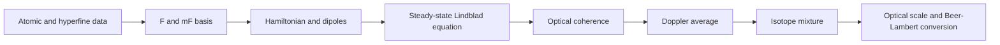

# Scientific scope

QuAntü is the ANID Thematic Research Ring project “Neutral-atom-based quantum computing in Chile” (ATE250066), organized into Algorithms, Experimental, and Theory groups. This page documents the spectroscopy component: progressive D2 absorption models for natural-abundance thermal rubidium vapor and open quantum system examples available in the repository. The description is based on the local [technical report](../reports/technical-progress/main.pdf), its [LaTeX sources](../reports/technical-progress/main.tex), and its [density-matrix derivation](../reports/technical-progress/density_matrix_model.tex). The report identifies Alexis R. Legón, Pontificia Universidad Católica de Chile, QuAntü Research Group, as its author and covers May–July 2026. That attribution applies to the report and does not establish authorship of every repository component.

## Progressive models

| Stage | Description | Implementation |
| --- | --- | --- |
| 1 | Sum of Gaussian profiles with a common Doppler width and effective centers and amplitudes. | [Model_1.ipynb](../notebooks/absorption/Model_1.ipynb) |
| 2 | Gaussian model with contributions from both isotopes at natural abundance. Retains effective position and weight corrections. | [Model_2.ipynb](../notebooks/absorption/Model_2.ipynb) |
| 3 | Optical susceptibility response with homogeneous broadening and thermal Doppler averaging. The notebook retains effective parameters and normalizations. | [Model_3.ipynb](../notebooks/absorption/Model_3.ipynb) |
| 4 | Steady-state density matrix with hyperfine structure, magnetic sublevels, coherent coupling, and Lindblad relaxation. | [Python module](../models/density-matrix/rb_d2.py), [fast execution](../models/density-matrix/run_fast.py), and [direct execution](../models/density-matrix/run_direct.py) |

These stages identify mechanisms behind the Doppler envelope, four resonance groups, coherences, and optical pumping. Greater physical complexity does not automatically imply smaller error: the density-matrix model still lacks metrics obtained with the same residual protocol as the first three stages.

## Preserved historical results

The following values appear in the notebooks' saved outputs and agree, after rounding, with the report table. During preparation, all cells of the three notebooks were rerun and reproduced these values within their rounding precision; the [numerical record](../validation/notebook-metrics.json) preserves versions and file hashes. This reproduction uses the same data and is not independent experimental validation.

| Model | Saved MSE | Saved MAE |
| --- | ---: | ---: |
| Gaussian | 0.006772 | 0.054760 |
| Isotope-aware Gaussian | 0.004758 | 0.052138 |
| Susceptibility | 0.004004 | 0.048501 |
| Density matrix | Pending | Pending |

The notebooks compute residuals after interpolating the theoretical curve onto the experimental grid. Some figures multiply residuals by 100 for display; that plotting factor is not applied to MSE or MAE. The metrics use each notebook's scales and calibrations and do not represent an absolute absorption-coefficient measurement.

## Density-matrix modeling chain

The retained transition is $5^2S_{1/2}\rightarrow5^2P_{3/2}$, near 780 nm. Each isotope is solved separately.

| Isotope | Nuclear spin | Ground states | Excited states | Hilbert dimension | Liouville dimension |
| --- | ---: | ---: | ---: | ---: | ---: |
| $^{85}\mathrm{Rb}$ | $5/2$ | 12 | 24 | 36 | 1296 |
| $^{87}\mathrm{Rb}$ | $3/2$ | 8 | 16 | 24 | 576 |

The basis includes all $m_F$ states of the D2 manifolds to calculate selection rules, pumping, and spontaneous-emission branching. The current Hamiltonian has no Zeeman energy: sublevels of a given $F$ remain degenerate. Explicitly resolving $m_F$ does not itself model an applied magnetic field.

The steady-state matrix satisfies $\mathcal{L}(x)\rho_{\mathrm{ss}}(x)=0$ and $\operatorname{Tr}\rho_{\mathrm{ss}}=1$. The absorption observable comes from the imaginary part of dipole-weighted optical coherences, rather than the total excited-state population. Some historical code comments refer to excited-state population; the implementation and detailed derivation use optical coherence.

The fast solver exploits the Liouvillian's affine detuning dependence: it computes a steady-state response grid, interpolates, and performs the Doppler average. The direct solver provides an alternative formulation over detuning and velocity. Python implementations are the repository's execution path. The original [fast MATLAB](../models/density-matrix/Rb_D2_density_matrix_fast_COHERENCE_ABS.m) and [direct MATLAB](../models/density-matrix/Rb_D2_density_matrix_slow_direct.m) scripts are preserved as backups and references for the report's historical derivation.

## Default parameters and calibrations

These values describe the historical fast script underlying the report; they are not measured parameters of a complete apparatus. Consult the Python executable's options for its execution grid and effective parameters.

| Parameter | Value |
| --- | --- |
| Temperature | 293 K |
| $^{85}\mathrm{Rb}$ / $^{87}\mathrm{Rb}$ fractions | 0.72 / 0.28 |
| Natural linewidth FWHM | 6.0666 MHz, common to both isotopes |
| Effective Rabi scale | 10.0 MHz before angular factors |
| Ground-state mixing | 0.05 MHz |
| Additional optical dephasing | 0 MHz |
| Polarization | $\pi$ |
| Laser grid | 1001 points from −6 to +6 GHz |
| Velocity grid | 1001 points; truncation at $\pm4\sigma_D$ |
| Steady-state response spacing | 0.5 MHz |
| Target maximum absorption | 0.42 |
| Comparison-axis transformation | $\Omega_{\mathrm{plot}}=1.0434\,\Omega_{\mathrm{theory}}+0.0781\,\mathrm{GHz}$ |

The theoretical convention is $\Omega=\nu_{85,\mathrm{D2\,cog}}-\nu_L$, using ordinary frequencies. Increasing the laser frequency moves $\Omega$ in the negative direction. The atomic origin and empirical axis transformation must be treated separately.

Mixing takes place at the optical-depth level, and absorption is constructed as $A=1-\exp(-\mathrm{OD})$. A global factor fixes the maximum absorption at 0.42. The plotted isotope curves are an additive decomposition of total absorption; they are not two independent transmission losses that can physically be added.

The model does not yet predict an absolute coefficient in SI units: the reduced dipole magnitude, vapor density, cell length, and division by the field required for an absolute susceptibility are not incorporated into that normalization. The default Rabi scale can produce saturation and optical pumping; it should not automatically be described as the weak-probe limit.

## Pending validation and extensions

The repository preserves existing implementations and figures. Having both solvers does not by itself demonstrate a complete numerical comparison. The report summary refers to checks against the direct formulation, while its future-work section still proposes benchmarking and convergence studies; systematic documented results are needed to close that scope.

The following checks should be extended beyond the small-grid cases already recorded in [validation](validation.md).

1. Check trace, Hermiticity, positivity, and steady-state residuals at representative detunings.
2. Verify normalized branching, selection rules, and transition centers before calibrating the axis.
3. Compare fast and direct solvers using common parameters and grids.
4. Quantify convergence in response spacing, velocity grid, and Doppler truncation.
5. Explore zero drive and convergence to linear response, separating saturation from pumping.
6. Compute density-matrix MSE and MAE using the same dataset and protocol as the other models.
7. Replace effective scales and relaxation rates with measured intensity, geometry, density, length, and rates.
8. Incorporate Zeeman terms, collisional broadening, and uncertainties when sufficient experimental parameters are available.

The D2 calculation is stationary, single-mode, and Markovian; it includes only D2 and independent one-dimensional velocity classes. It does not simulate time-dependent scans, pulses, diffusion, recoil, or velocity-changing collisions. The [Python two-level example](open-quantum-systems.md) separately covers temporal dynamics and fluorescence in an idealized system; it does not replace a complete time-dependent rubidium model. [MOT](../education/mot/README.md), [Qiskit](../education/qiskit/README.md), and outreach materials provide educational context; their presence does not establish an operational experimental MOT or quantum-computing experiments performed on hardware.

See [report traceability](report-traceability.md), [data provenance](data-provenance.md), and the [report bibliography](../reports/technical-progress/references.bib).

## Linewidth convention in the Voigt explorers

In the historical interfaces, `gamma_MHz` enters the Voigt profile as the Lorentzian half width at half maximum (HWHM); its FWHM is `2*gamma_MHz`. The historical initial value of 6 MHz is retained to reproduce the curves. In the density-matrix model, `linewidth=6.0666 MHz` represents FWHM: the parameters should not be equated numerically without converting conventions. The interface controls explicitly identify HWHM.
